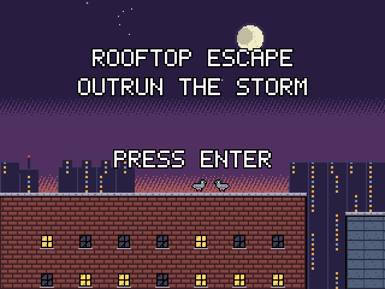
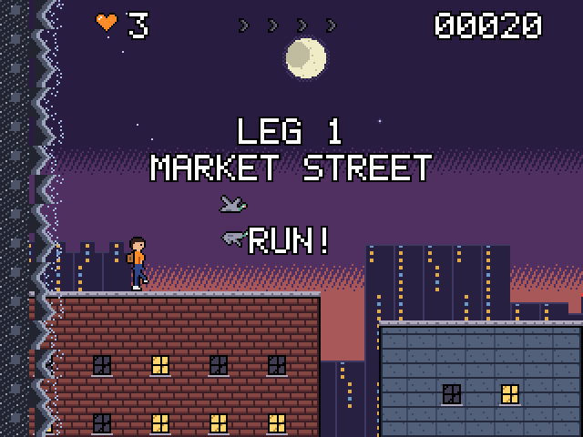
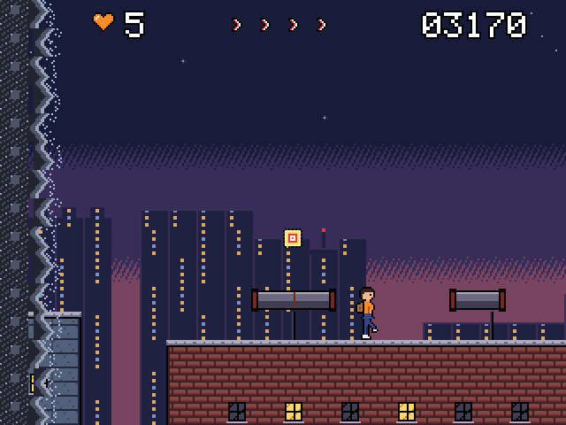

# Rooftop Escape

Outrun a storm across ten stretches of city rooftops. Jump gaps, slide under signs, climb walls and ride clotheslines while keeping your momentum.

For the Zeal 8-bit computer with the Video Board, running Zeal 8-bit OS.

  

## Controls

Menu prompts default to a connected SNES pad and follow the last device used
in the menu. The selected keyboard/pad display stays fixed during the game.

| Action | Keyboard | SNES pad |
|---|---|---|
| Push ahead / ease off (you never stop) | Right / Left | D-pad |
| Jump (hold for higher), climb a wall, jump off a clothesline | Z, Space or Up | B or Up |
| Slide (on a roof), drop faster (in the air) | Down or X | Down or A |
| Pause | Enter | Start |
| Quit to title | Right Shift | Select |

Enter starts the game on the title screen.

## How to play

- You always run right. Push ahead or ease off to manage the distance from the storm.
- Chain jumps, slides, wall climbs and rope jumps to build momentum.
- Reach the hatch at the end of each leg. Falling or being caught costs a life.

## Build

Install the Zeal Development Environment (ZDE) and its SDK dependencies, then run
these commands from this repository:

```sh
zde deps install zgdk
zde deps install zar
zde cmake
```

The build produces `bin/rooftop.bin` and `bin/rooftop.zar`.
Use a current ZGDK installation.

## Run

For Zeal-NativeEmulator, mount the output folder as HostFS:

```sh
zeal-native -r /path/to/os_with_romdisk.img -H bin
```

At the ZOS prompt:

```text
cd H:/
exec rooftop.bin
```

On hardware, copy the `.bin` and `.zar` together and run the game from that folder.

Build variants, asset editing and optional development tools are documented in
[the development guide](docs/development.md).

## License

Copyright 2026 David Higgins. Game code and original assets are licensed under
[Apache License 2.0](LICENSE). External SDKs and tools retain their own licenses.
